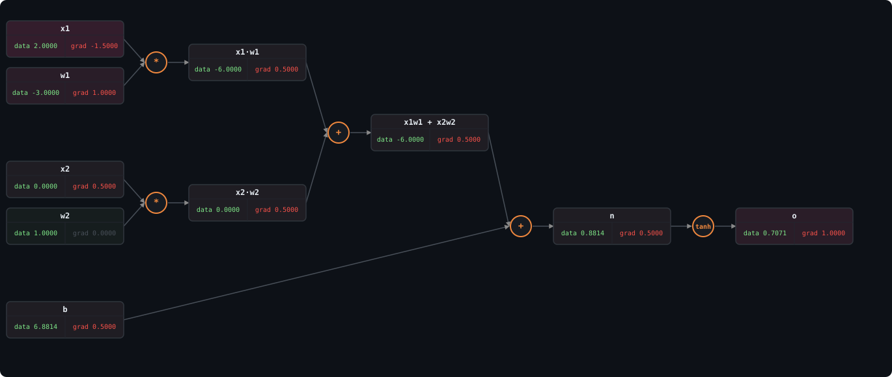

# micrograd

A scalar-valued autograd engine and neural net library, written from scratch in Python. No PyTorch, no NumPy, no frameworks — just `math` and `random`.

Started from [Karpathy's micrograd](https://github.com/karpathy/micrograd), but this version goes further. I wanted to actually understand the pieces, not just watch the lecture and nod along. So I added the things I kept reading about in papers and couldn't explain from first principles.

### Computation graph of a single neuron — forward pass values + backpropagated gradients

<p align="center">
  
</p>

Every node stores its forward-pass value (<span style="color:#7ee787">data</span>) and the gradient of the output with respect to that node (<span style="color:#f85149">grad</span>), computed automatically via reverse-mode autodiff.

## What's in here

**Autograd engine** ([`engine.py`](micrograd/engine.py)) — a `Value` class that tracks a computation graph of scalar operations and computes gradients via reverse-mode autodiff (backpropagation). Supports `+`, `-`, `*`, `/`, `**`, `exp`, `log`, and full Python operator overloading (`__radd__`, `__rmul__`, `__rtruediv__`, etc.) so expressions like `2 * x + 1` just work.

**Neural net library** ([`nn.py`](micrograd/nn.py)) — `Neuron`, `Layer`, and `MLP` modules built on top of the engine, plus:
- **GELU activation** — the one used in GPT-2, GPT-3, BERT, LLaMA. Implemented with the exact Gaussian CDF formulation and its analytical derivative.
- **Numerically-stable softmax** — uses the max-subtraction trick so logits of 1000+ don't blow up to `inf`.
- **Cross-entropy loss** — negative log-likelihood, the standard classification loss.
- **Adam optimizer** — with momentum, RMSProp scaling, and bias correction. Not just SGD.

**Test suite** ([`test_engine.py`](test_engine.py)) — 24 tests covering every operation, gradient correctness via central finite differences (rel error < 1e-5 across the full graph), and a benchmark comparing backprop vs numerical differentiation.

## Extensions beyond base micrograd

| What I added | Why |
|:---|:---|
| GELU activation + analytical derivative | It's what modern transformers actually use. ReLU has the dying neuron problem; GELU doesn't. I wanted to derive `dGELU/dx = Φ(x) + x·φ(x)` myself and verify it against finite differences. |
| Adam optimizer | Vanilla SGD oscillates in narrow loss valleys. Adam's per-parameter adaptive learning rates fix that. I implemented the full algorithm: biased moment estimates, bias correction, epsilon stability. |
| Stable softmax (max trick) | Raw `exp(1000.0)` overflows IEEE 754 floats. Subtracting `max(logits)` keeps the math identical but the largest exponent becomes `e^0 = 1`. I proved the algebraic equivalence in my notes. |
| Cross-entropy loss | Needed for multi-class classification. `loss = -log(softmax(logits)[target])` |
| Numerical gradient checker | Central differences: `(f(x+h) - f(x-h)) / 2h`. Runs across every op in a compound graph. If the analytical grad disagrees with the numerical one, something is wrong with the backward pass. |
| Gradient benchmark | Measures the O(1) vs O(N) scaling difference between backprop and numerical diff. |

## The benchmark that made backprop click

I kept reading "backprop is efficient" without a concrete sense of *how much*. So I measured it.

Backprop computes **all N gradients** in roughly 2x the cost of a single forward pass. Numerical differentiation needs **2N separate forward passes** — two per parameter.

```
N (params)  Backprop     Numerical (2N passes)  Speedup
─────────────────────────────────────────────────────────
5           0.062 ms     0.306 ms                 5x
10          0.064 ms     0.941 ms                15x
20          0.111 ms     3.047 ms                28x
40          0.189 ms    10.216 ms                54x
```

The speedup grows linearly with N. At 40 parameters, backprop is **54x faster**. At the scale of a real model with millions of parameters, numerical differentiation is simply not an option.

But there's a tradeoff: backprop needs to **store every intermediate value** from the forward pass in memory. Numerical diff can throw them away immediately. This compute-vs-memory tension is exactly why techniques like activation checkpointing and FlashAttention exist in production systems — they trade a bit of extra compute to avoid storing everything in GPU memory.

## Project structure

```
micrograd/
├── micrograd/
│   ├── engine.py        # Value class, computation graph, backward()
│   └── nn.py            # Neuron, Layer, MLP, softmax, cross-entropy, Adam
├── examples/
│   └── demo.py          # Train an MLP on 4-class classification
├── notes/
│   └── WEEK1_CONCEPTS_AND_DOUBTS.md   # Detailed learning notes
├── rough/               # Working notebooks from following along
│   ├── backprop.ipynb
│   ├── micrograd_lecture_first_half_roughly.ipynb
│   └── micrograd_lecture_second_half_roughly.ipynb
└── test_engine.py       # 24 tests, gradient checker, benchmark
```

## Run it

```bash
python3 -m venv .venv
source .venv/bin/activate
pip install -r requirements.txt

# Run tests
python test_engine.py

# Run the classification demo + benchmark
python examples/demo.py
```

## Learning notes

The [`notes/`](notes/) directory has my detailed write-ups of every concept and question I worked through: why gradients accumulate with `+=`, how Python's operator protocol dispatches `__rtruediv__`, the algebraic proof behind the softmax max trick, how Adam's bias correction works, and the compute-vs-memory tradeoff that connects this toy engine to real GPU systems.

These aren't polished tutorials. They're the actual notes I wrote while figuring things out.

## Acknowledgements

Built while working through [Andrej Karpathy's Neural Networks: Zero to Hero](https://www.youtube.com/playlist?list=PLAqhIrjkxbuWI23v9cThsA9GvCAUhRvKZ). The base micrograd design is his. The extensions, tests, notes, and benchmarks are mine.
